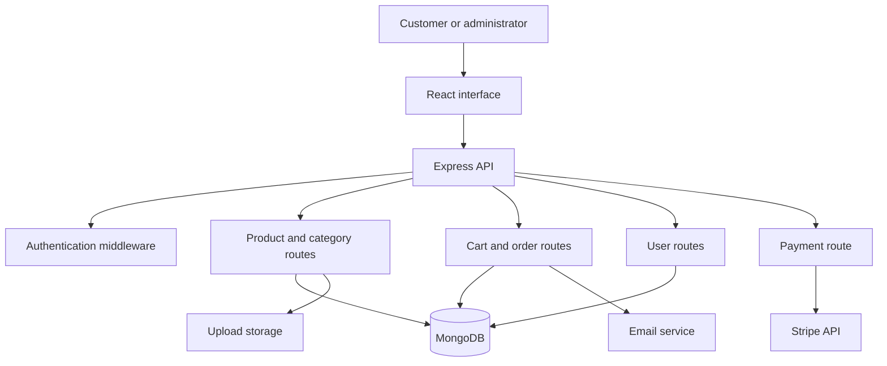

# Grocery React

A full-stack grocery and e-commerce application built with React interfaces and a Node.js/Express backend. The repository contains a customer-facing React package, a separate Vite-based administration interface, and backend code for accounts, products, categories, carts, orders, uploads, email, and payment integration work.

> **Status:** Development project under documentation and security review. A route or dependency being present in source does not mean its workflow is secure or operational. Review [Known Limitations](docs/KNOWN_LIMITATIONS.md) and [Security Review](docs/SECURITY_REVIEW.md) before deployment.

[](https://github.com/Brajesh31/Grocery-react-main/actions/workflows/codeql.yml)
[](https://github.com/Brajesh31/Grocery-react-main/actions/workflows/markdown-lint.yml)
[](https://github.com/Brajesh31/Grocery-react-main/issues)

## Table of contents

- [1. Overview](#1-overview)
- [2. Goals and scope](#2-goals-and-scope)
- [3. Current capabilities](#3-current-capabilities)
- [4. Technology stack](#4-technology-stack)
- [5. Repository structure](#5-repository-structure)
- [6. Architecture](#6-architecture)
- [7. Prerequisites](#7-prerequisites)
- [8. Installation](#8-installation)
- [9. Configuration and secrets](#9-configuration-and-secrets)
- [10. Running the applications](#10-running-the-applications)
- [11. Backend API overview](#11-backend-api-overview)
- [12. Data model](#12-data-model)
- [13. Testing and quality](#13-testing-and-quality)
- [14. Security and privacy](#14-security-and-privacy)
- [15. Accessibility](#15-accessibility)
- [16. Troubleshooting](#16-troubleshooting)
- [17. Known limitations](#17-known-limitations)
- [18. Roadmap](#18-roadmap)
- [19. Contributing](#19-contributing)
- [20. Licensing](#20-licensing)

## 1. Overview

Grocery React is intended to provide an online grocery-shopping experience. The codebase combines React user interfaces with an Express API and MongoDB models. The backend source includes account registration and login handlers, product and category routes, user-specific cart operations, order workflows, image upload middleware, email notification code, and a Stripe payment-intent route that requires repair.

The repository also includes a Vite React administration dashboard derived from the Gradient Able Free React Admin Template. Its existing license and attribution files are retained in their original location. See [Licensing](docs/LICENSING.md).

## 2. Goals and scope

The intended scope is to support product discovery, account access, shopping carts, order management, administrative workflows, image uploads, and payment-provider integration. Feature status varies. This documentation distinguishes code that exists from workflows that have been tested.

## 3. Current capabilities

| Area | Source evidence | Qualification |
|---|---|---|
| Customer frontend | React 18 package under `Client/` | UI flows require runtime verification |
| Admin frontend | React 18 + Vite under `Client/react/` | Dashboard template and sample views are present |
| Registration and login | Handlers in `Server/server.js` | Authentication needs urgent hardening |
| User profile | `Server/routes/userRoutes.js` | Effective mount path must be verified |
| Products | `Server/routes/productRoutes.js` | CRUD and image upload handlers exist |
| Categories | `Server/routes/categoryRoutes.js` | List and create handlers exist |
| Cart | `Server/routes/cartRoutes.js` | Add, read, remove, and quantity handlers exist |
| Orders | `Server/routes/orderRoutes.js` | Create, history, admin list, delete, and status handlers exist |
| Payments | `Server/routes/stripe.js` | Client initialization is incomplete |
| Email | Nodemailer usage in backend | Configuration is inconsistent and contains exposed credential material |

## 4. Technology stack

| Layer | Technology |
|---|---|
| Customer frontend | React 18, React Router, Bootstrap, Axios, Create React App |
| Admin frontend | React 18, Vite, React Router, React Bootstrap, ApexCharts, Formik, Yup, Sass |
| Backend | Node.js, Express 4 |
| Persistence | MongoDB and Mongoose 8 |
| Authentication | JSON Web Tokens and bcrypt-related packages |
| Uploads | Multer |
| Payments | Stripe packages; route requires repair |
| Email | Nodemailer |

The repository does not currently commit application lockfiles for the package roots. Dependency resolution is therefore not fully reproducible.

## 5. Repository structure

```text
Grocery-react-main/
├── .github/workflows/
├── Client/                 # Customer React application
│   ├── package.json
│   └── react/              # Vite admin dashboard application
│       ├── package.json
│       └── src/
├── Server/
│   ├── middleware/
│   ├── models/
│   ├── routes/
│   ├── uploads/
│   ├── package.json
│   └── server.js
├── docs/
├── .gitignore
├── CHANGELOG.md
├── CONTRIBUTING.md
├── CODE_OF_CONDUCT.md
├── SECURITY.md
├── ACCESSIBILITY.md
├── SUPPORT.md
└── README.md
```

This is a simplified structure. Generated dependency folders and uploaded assets are omitted. The server currently imports a route module that was not present in the inspected tracked route list; see [Known Limitations](docs/KNOWN_LIMITATIONS.md).

## 6. Architecture



This describes intended component relationships inferred from source, not a verified end-to-end deployment. Detailed notes: [Architecture](docs/ARCHITECTURE.md).

## 7. Prerequisites

- Supported Node.js LTS release and npm.
- Git.
- MongoDB for backend persistence.
- A modern browser.
- Sandbox credentials for external services only after configuration is repaired.

The Node.js version is not currently pinned. Select and document a supported version before production use.

## 8. Installation

Clone the repository:

```bash
git clone https://github.com/Brajesh31/Grocery-react-main.git
cd Grocery-react-main
```

Install and start the customer frontend:

```bash
cd Client
npm install
npm start
```

Install and start the nested Vite dashboard in a separate terminal:

```bash
cd Grocery-react-main/Client/react
npm install
npm run start
```

Install backend dependencies:

```bash
cd Grocery-react-main/Server
npm install
```

The backend package currently has no working start script. The apparent entry point is `server.js`, but its imports and configuration must be repaired before it can be treated as runnable. See [Installation](docs/INSTALLATION.md).

## 9. Configuration and secrets

**Do not commit credentials, API keys, tokens, passwords, database connection strings, or private certificates.** Inspection found hardcoded credential material in backend source and a tracked environment file. Treat exposed credentials as compromised, rotate them at their providers, and review Git history. A `.gitignore` rule does not untrack files already committed.

Current source uses inconsistent email variable names, embeds a local MongoDB URI, and hardcodes a JWT secret. The Stripe route references an uninitialized client. See [Configuration](docs/CONFIGURATION.md) and [Security](SECURITY.md).

## 10. Running the applications

| Package | Directory | Current command |
|---|---|---|
| Customer frontend | `Client/` | `npm start` |
| Admin frontend | `Client/react/` | `npm run start` |
| Backend | `Server/` | No working start script currently defined |

Run separate terminals. The backend must be repaired before the frontends can use live API functionality.

## 11. Backend API overview

Source-level route inventory:

| Domain | Handler paths visible in source |
|---|---|
| Authentication | `POST /api/register`, `POST /login` |
| Users | `GET /api/getUser`, `POST /api/addUser`, `PUT /api/updateUser/:id`, `DELETE /api/deleteUser/:id` |
| Profile | `GET /profile` in user router |
| Products | `POST /add`, `GET /all`, `PUT /update/:id`, `DELETE /delete/:id` |
| Categories | `GET /`, `POST /add` |
| Cart | `POST /add`, `GET /cartshow`, `DELETE /cart/delete/:id`, `PATCH /:id` |
| Orders | `POST /create`, `GET /history`, `GET /admin/orders`, `DELETE /admin/orders/:orderId`, `PUT /admin/orders/:orderId/status` |
| Payments | `POST /create-payment-intent` |

Actual full URLs depend on Express router prefixes. Some routes are duplicated or inconsistently mounted. The order route import is unresolved, and the payment handler is not operational. See [API Reference](docs/API_REFERENCE.md).

## 12. Data model

The Mongoose models describe User, Product, Category, Cart, and Order entities. Products reference categories; cart and order items reference products; carts and orders reference users. The schemas need further validation, indexes, ownership checks, and transaction design.

## 13. Testing and quality

A passing comprehensive test suite has not been verified. The backend test command is a placeholder that exits with an error. Frontend test tooling exists in package metadata, but actual coverage and passing results have not been established.

Before release, add unit, integration, authorization, upload, payment, frontend, and accessibility tests. See [Testing](docs/TESTING.md).

## 14. Security and privacy

Security is a release blocker. Rotate exposed credentials, remove secrets from current files and Git history, centralize configuration, enforce admin authorization on every privileged route, calculate order totals from trusted database prices, validate uploads, and verify payment webhooks. See [Security Review](docs/SECURITY_REVIEW.md) and [Data Handling](docs/DATA_HANDLING.md).

## 15. Accessibility

Use semantic HTML, meaningful labels, keyboard-operable controls, visible focus, sufficient contrast, responsive layouts, and accessible validation. No WCAG conformance claim is made because a formal audit has not been completed. See [Accessibility](ACCESSIBILITY.md).

## 16. Troubleshooting

| Symptom | Likely cause | Action |
|---|---|---|
| Backend fails at startup | Missing imported route module | Compare imports with `Server/routes/` |
| MongoDB connection refused | Local database unavailable | Start MongoDB and verify URI |
| Frontend API requests fail | API URL or CORS mismatch | Check API configuration and allowlist |
| Payment endpoint fails | Stripe client not initialized | Repair server-side Stripe setup |
| Email delivery fails | Inconsistent config names or exposed credentials | Rotate and centralize mail settings |
| Cart quantity update fails | Inconsistent user ID property | Standardize auth claims and add tests |
| Dependency versions differ | No package lockfiles | Generate and commit lockfiles |

## 17. Known limitations

Confirmed issues include hardcoded secrets, a tracked environment file, hardcoded administrator/mail credential material, a missing route import, an uninitialized Stripe client, inconsistent admin authorization, client-trusted order price fields, a placeholder backend test command, missing lockfiles, and committed generated dependencies. Full details: [Known Limitations](docs/KNOWN_LIMITATIONS.md).

## 18. Roadmap

1. Rotate exposed credentials and remediate Git history.
2. Repair backend startup and route registration.
3. Centralize and validate runtime configuration.
4. Enforce authentication and role-based authorization.
5. Repair payment processing and webhook verification.
6. Harden uploads and request validation.
7. Add reproducible dependencies and automated tests.
8. Verify customer and admin workflows end to end.
9. Complete accessibility, privacy, and operational reviews.

## 19. Contributing

Read [CONTRIBUTING.md](CONTRIBUTING.md) before submitting changes. Security issues must be reported privately using [SECURITY.md](SECURITY.md), not through public issues.

## 20. Licensing

The nested admin dashboard includes an existing MIT license and upstream template attribution. The backend package declares ISC metadata. A root license has not been added because the combined ownership and third-party licensing status requires review. Preserve all existing notices. See [Licensing](docs/LICENSING.md).

Last updated: 2026-11-14 04:48 UTC
