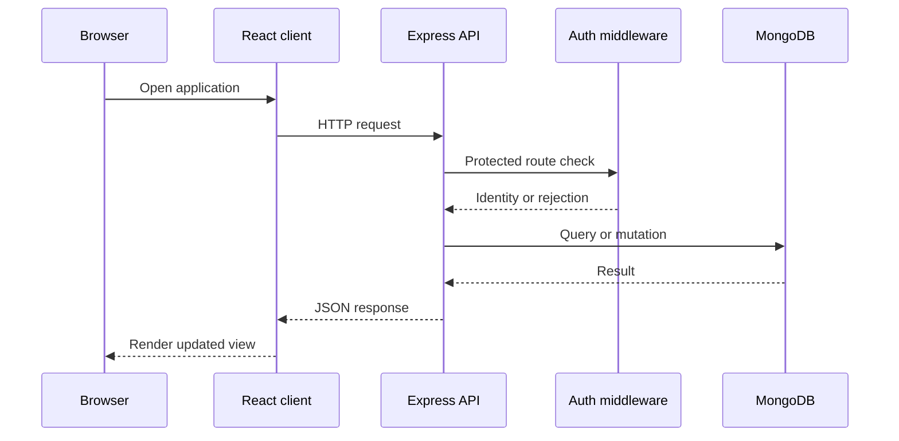

# Architecture

## Table of contents

- [1. System context](#1-system-context)
- [2. Repository components](#2-repository-components)
- [3. Request lifecycle](#3-request-lifecycle)
- [4. Data layer](#4-data-layer)
- [5. External integrations](#5-external-integrations)
- [6. Architectural risks](#6-architectural-risks)
- [7. Recommended direction](#7-recommended-direction)

## 1. System context

The intended system has browser-based React clients communicating with an Express API. The API uses Mongoose models to persist users, products, categories, carts, and orders. It also contains code for email notifications, file uploads, and a Stripe payment-intent endpoint.

## 2. Repository components

| Component | Location | Responsibility |
|---|---|---|
| Customer React package | `Client/` | Customer-facing web application |
| Admin dashboard package | `Client/react/` | Dashboard shell, routes, menus, components, and UI views |
| API server | `Server/server.js` | Express app, middleware, database connection, and user handlers |
| Route modules | `Server/routes/` | Domain-specific HTTP handlers |
| Middleware | `Server/middleware/` | Authentication and image upload handling |
| Models | `Server/models/` | Mongoose schemas |
| Upload storage | `Server/uploads/` | Locally stored uploaded assets |

## 3. Request lifecycle

This sequence is conceptual. Confirm route prefixes, authentication behaviour, and response shapes with integration tests.

## 4. Data layer

The current Mongoose models include User, Product, Category, Cart, and Order. Products reference categories. Cart and order line items reference products. Cart and order records reference users.

Recommended improvements include schema constraints, indexes for common lookups, consistent error handling, transaction handling for multi-step operations, and server-side validation.

## 5. External integrations

- **MongoDB:** currently connected using a hardcoded local URI in the server entry point.
- **Email:** Nodemailer is used, but credential names and configuration are inconsistent.
- **Stripe:** a route exists but references a client that is not initialized in active code.
- **Twilio:** the package is installed and imported, but an active feature contract has not been verified.
- **Image storage:** Multer writes to a local uploads directory. Add size limits, content validation, safe storage, and a retention policy.

## 6. Architectural risks

1. Backend route imports do not fully match the tracked route file inventory.
2. Authentication signing and verification use hardcoded secrets.
3. Administrative handlers are not consistently protected by role checks.
4. Payment handling is incomplete.
5. Local filesystem uploads may not persist on ephemeral hosting.
6. Frontend package roots use different build tools.
7. Application lockfiles are missing.

## 7. Recommended direction

As a staged refactor, separate route registration, configuration, services, controllers, validation schemas, and error middleware. Add tests before changing these boundaries. Do not restructure the entire application merely to match this diagram.
