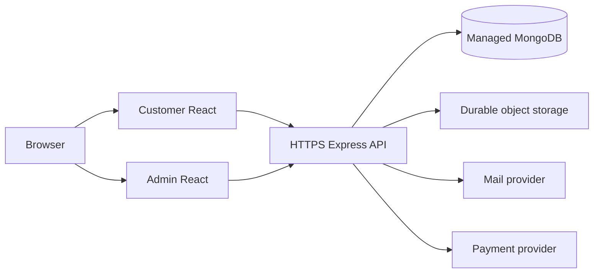

# Deployment Guide

## Table of contents

- [1. Deployment status](#1-deployment-status)
- [2. Recommended topology](#2-recommended-topology)
- [3. Pre-deployment requirements](#3-pre-deployment-requirements)
- [4. Build and runtime](#4-build-and-runtime)
- [5. Database and storage](#5-database-and-storage)
- [6. Secrets and integrations](#6-secrets-and-integrations)
- [7. Operations](#7-operations)
- [8. Rollback](#8-rollback)

## 1. Deployment status

The current codebase is not ready for production deployment. Backend startup, secret management, authentication, administrative authorization, and payment integration must be repaired first. This is a planning guide, not evidence of a validated deployment.

## 2. Recommended topology

A typical target architecture hosts customer and admin frontends as separate static applications, runs the Express API as a managed Node.js process, uses managed MongoDB, and stores uploads in durable object storage.

## 3. Pre-deployment requirements

Resolve all critical findings in [Security Review](SECURITY_REVIEW.md), repair route imports, define a server start script, centralize configuration, commit lockfiles, add health checks and tests, configure HTTPS and trusted origins, and protect all admin routes server-side.

## 4. Build and runtime

Build the customer frontend from `Client/` and the admin dashboard from `Client/react/`. Run the backend as a managed process after a reliable start script is defined. Do not expose development servers in production. Use health monitoring, structured logs, and graceful shutdown.

## 5. Database and storage

Use managed MongoDB with restricted network access, least-privilege credentials, backups, and tested restore procedures. Local uploads may not persist on ephemeral hosting. Use object storage or a persistent volume with explicit access, retention, and backup controls.

## 6. Secrets and integrations

Store JWT, database, email, and payment secrets in the hosting platform's secret manager. Rotate all publicly exposed values. Use payment-provider test mode and implement webhook signature verification before accepting payment state changes.

## 7. Operations

Monitor process health, database connectivity, error rates, failed jobs, payment reconciliation, storage capacity, and authentication anomalies. Do not log credentials, access tokens, full payment details, or unnecessary personal data.

## 8. Rollback

Keep immutable release artifacts and migration notes. Define rollback procedures for frontend and backend releases. Prefer backward-compatible database changes and verify backups before risky migrations.
